<picture>
  <source media="(prefers-color-scheme: dark)" srcset="./assets/banner-dark.svg">
  <source media="(prefers-color-scheme: light)" srcset="./assets/banner-light.svg">
  
</picture>

### 🏁 Open-source builds out of the eragon.mx garage

**rider and gearhead** · self-hosted everything · built in orange and black

## 🛠️ Spec Sheet

| | |
|---|---|
| **Rider** | rider and gearhead |
| **Class** | MX · open-source · self-hosted |
| **Displacement** | small builds, big torque |
| **Fuel** | coffee and premix |
| **Tires** | knobbies, always |
| **Status** | 🟠 in the shop, building |

## 🏍️ In the Garage

| Build | What it does | Status |
|---|---|---|
| 🔗 **[collar-landing](https://github.com/YOUR-ORG/collar-landing)** | Self-hosted link-in-bio page for QR codes and NFC tags, with a private backend for you and your keyholder | 🟠 Building |
| 📸 **[gallery](https://github.com/YOUR-ORG/gallery)** | Photo gallery setup with prints and booking | ⚪ On the stand |
| 🧰 **[toolbox](https://github.com/YOUR-ORG/toolbox)** | Small scripts and configs pulled from the other builds | ⚪ On the stand |

> **Pit lane:** Every build is meant to be forked and run on your own server. Grab one, tune it, ride it.

## 🔧 Wrenching on a Build

1. **Fork it.** Make it yours.
2. **Read the build's README** for setup, since every bike's a little different.
3. **Open an issue** if something rattles loose.
4. **Send a PR** if you fixed it. Clean welds only.

**[eragon.mx](https://eragon.mx)** · see you at the track 🏁

Built in the garage · All builds open source unless noted

