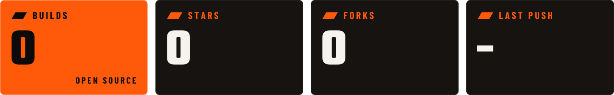

<picture>
  <source media="(prefers-color-scheme: dark)" srcset="./assets/banner-dark.svg">
  <source media="(prefers-color-scheme: light)" srcset="./assets/banner-light.svg">
  
</picture>

Rider and gearhead. This is the garage for [eragon.mx](https://eragon.mx): the open-source tools that run the site, built to be self-hosted. Your server, your data. Roll one out and run your own.

<picture>
  <source media="(prefers-color-scheme: dark)" srcset="./assets/metrics-dark.svg">
  <source media="(prefers-color-scheme: light)" srcset="./assets/metrics-light.svg">
  
</picture>

## IN THE GARAGE

| Build | What it does | Status |
|---|---|---|
| **[collar-landing](https://github.com/YOUR-ORG/collar-landing)** | A link page for your collar tag. Scan the QR code or tap the NFC chip to open it. Includes a private dashboard for you and your keyholder. | 🟠 On the stand |
| [Next build] | | |

🟠 On the stand: in progress · 🏁 Race ready: stable and safe to run

## WRENCH ON IT

Each build ships with its own setup guide. Fork it, tune it, make it yours.

Something rattling loose? Open an issue. Fixed it yourself? Send a pull request. Anything else, [message me](https://eragon.mx).

<picture>
  <source media="(prefers-color-scheme: dark)" srcset="./assets/divider-dark.svg">
  <source media="(prefers-color-scheme: light)" srcset="./assets/divider-light.svg">
  
</picture>

<picture>
  <source media="(prefers-color-scheme: dark)" srcset="./assets/signoff-dark.svg">
  <source media="(prefers-color-scheme: light)" srcset="./assets/signoff-light.svg">
  
</picture>
